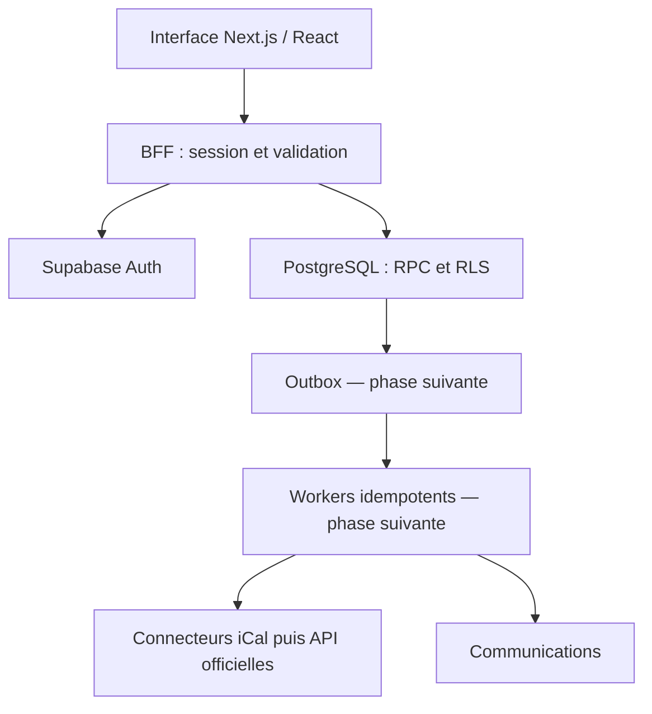
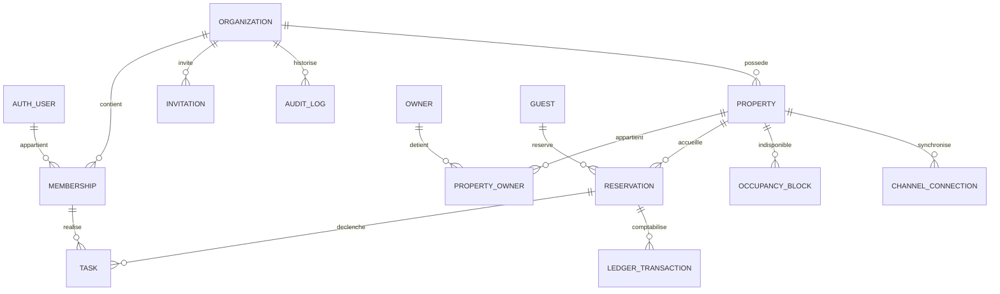

# HostFlow — Architecture et plan d’implémentation

Version 0.2 construite à partir du socle v0.1 après audit complet. Supabase distant est raccordé ; les permissions et l’isolation sont validées avec de vraies sessions Auth. Les tables métier ci-dessous sont un schéma cible, pas des fonctionnalités livrées.

## 1. Architecture générale

Monolithe modulaire : interface React / Next.js App Router en TypeScript, Tailwind et shadcn/ui ; API serveur BFF ; services applicatifs ; Supabase Auth et PostgreSQL (RLS) comme source de vérité. Storage privé et Realtime seront activés avec les modules concernés. Aucun stockage métier dans le navigateur.

Le runtime Sites utilise Vinext, compatible avec les conventions Next.js App Router, sur Cloudflare Workers. Next.js est installé ; des commandes Next.js natives distinctes sont prévues. La compatibilité Vinext ne certifie pas une équivalence de tous les comportements. La couche métier et la base ne dépendent ni de Vinext ni de Cloudflare.



Module Properties livré en v0.3 : voir [PROPERTIES-v0.3.md](PROPERTIES-v0.3.md) pour le schéma effectif. Modules futurs : owners, reservations, calendar, operations, channel-sync, automations, communications, finance. Chaque module expose ses services et contrats ; aucun accès transversal arbitraire aux tables. Les adapters s’occupent des transports externes.

## 2. Schéma de base — fondations

| Entité                   | Champs structurants                                                                                       | Contraintes / accès                                                     |
| ------------------------ | --------------------------------------------------------------------------------------------------------- | ----------------------------------------------------------------------- |
| auth.users               | id, email, email_confirmed_at                                                                             | Identité globale Supabase, jamais exposée directement                   |
| organizations            | id, name, slug, country, timezone, currency, created_by, timestamps, team_setup_completed_at              | Racine du tenant ; lecture membre actif ; écriture admin                |
| organization_members     | id, organization_id, user_id, display_name, role, status, created_by, timestamps                          | Unique (organization_id,user_id) ; profil contextualisé au tenant       |
| organization_invitations | id, organization_id, email, role, token_hash, expires_at, accepted_at, revoked_at, created_by, timestamps | Hash du token non lisible ; owner/admin uniquement                      |
| audit_logs               | id, organization_id, actor_id, action, entity_type, entity_id, metadata, created_at                       | Append-only ; aucune donnée secrète ; consultation admin                |
| private.platform_admins  | user_id, created_at                                                                                       | Hors schéma API ; octroi opérateur uniquement ; aucun contournement RLS |

Toutes les données métier appartiennent à une Organization. Seules exceptions : identité d’authentification globale et registre technique des administrateurs plateforme. La table `profiles` contient id, first_name, last_name, avatar_url, phone et timestamps. RLS limite sa lecture et sa mise à jour à son titulaire. `list_team(organization_id)` fournit une projection limitée (nom/email/rôle/statut) aux responsables du tenant, jamais les téléphones ou les appartenances à d’autres tenants. Le nom historique de l’adhésion est conservé pour compatibilité.

## 3. Schéma cible des modules

Convention : UUID, organization_id NOT NULL, created_at / updated_at, created_by ; unique (organization_id,id), FK composites (organization_id,parent_id), index commençant par organization_id. Horodatages timestamptz en UTC ; dates de séjour dans le fuseau IANA du logement. Montants en unités monétaires mineures entières, devise explicite, taux en points de base, arrondi documenté.

| Module          | Tables cibles et champs                                                                                                                                                                                                    |
| --------------- | -------------------------------------------------------------------------------------------------------------------------------------------------------------------------------------------------------------------------- |
| Logements       | properties (owner_id, name, address, lat/lng, timezone, capacity, bedrooms, beds, bathrooms, status), property_amenities, property_media, property_secrets (accès, Wi-Fi, notes), property_documents                       |
| Propriétaires   | owners (membership_id nullable, contact), property_owners (parts et dates d’effet), owner_blocks (property_id, date_range, approval_status), owner_statements                                                              |
| Voyageurs       | guests (membership_id nullable, contact), reservation_guest_access ; aucun annuaire accessible aux voyageurs                                                                                                               |
| Réservations    | reservations (property_id, guest_id, source, external_id, check_in, check_out, guests_count, status, gross_minor, fees_minor, commission_bps, commission_minor, owner_net_minor, currency, notes), reservation_charges     |
| Calendrier      | occupancy_blocks (property_id, date_range, kind, reservation_id nullable, active) : registre unique des indisponibilités                                                                                                   |
| Channel sync    | channel_connections (property_id, provider, secret_ref, enabled), external_calendar_events (connection_id, uid, recurrence_id, external_updated_at, raw_hash), sync_runs, sync_conflicts                                   |
| Opérations      | tasks (property_id, reservation_id, assignee_membership_id, type, priority, status, scheduled_at, started_at, completed_at, instructions, duration_seconds), task_checklist_items, task_photos, task_comments, task_issues |
| Automatisations | automation_rules (trigger_key, conditions_json, actions_json, version, enabled), domain_events, outbox_jobs, automation_runs (event_id, rule_version, idempotency_key)                                                     |
| Communications  | message_templates (channel, locale, body, version), conversations, messages (recipient_ref, scheduled_at, provider_message_id, delivery_state), message_deliveries                                                         |
| Finance         | ledger_transactions, ledger_entries, expenses, payout_reconciliations, owner_statements ; écritures immuables, corrections par contre-écriture                                                                             |
| Fichiers        | documents (object_path, media_type, size, category, property_id, owner_id), document_access_grants ; bucket privé et URL signée courte                                                                                     |



Anti-double réservation : btree_gist et exclusion PostgreSQL sur `(organization_id WITH =, property_id WITH =, daterange(check_in,check_out,'[)') WITH &&)` dans occupancy_blocks actifs. Réservation et bloc dans la même transaction, y compris séjours propriétaires et blocages internes. Check-out = prochain check-in autorisé. Annulation désactive le bloc. Concurrence arbitrée par la base. Un événement iCal conflictuel reste en staging / sync_conflicts ; aucune réservation existante écrasée.

## 4. Multi-tenant et permissions

- L’organisation sélectionnée dans le cookie HttpOnly `hf-organization` n’est jamais une preuve d’autorisation. Chaque requête vérifie auth.uid() et l’adhésion active.
- RLS sur toutes les tables exposées ; aucune politique anonyme ; aucune clé service_role dans l’interface ou l’API applicative.
- Écritures sensibles par implémentations transactionnelles SECURITY DEFINER dans `private`, enveloppes RPC SECURITY INVOKER dans `public`, search_path vide, noms qualifiés, EXECUTE révoqué à PUBLIC puis accordé explicitement. Aucun droit issu de user_metadata.
- Rôles relus en base à chaque requête : révocation immédiate sans attendre expiration JWT.
- Changements d’équipe sérialisés par verrou sur l’organisation ; interdiction de rétrograder ou suspendre le dernier owner actif, même en concurrence.
- Toute relation métier future emploie une FK composite. Les filtres UI restent une défense complémentaire.
- Super Admin : registre technique ; pas de portail plateforme ni accès support dans ce lot. Un futur accès support exige consentement, durée limitée et audit.

| Rôle                     | Périmètre actuel                                                                       | Périmètre métier prévu                                              |
| ------------------------ | -------------------------------------------------------------------------------------- | ------------------------------------------------------------------- |
| Super Admin              | Registre privé, sans élévation tenant                                                  | Santé plateforme ; accès support explicite uniquement               |
| Owner                    | Contrôle total, attribution owner/admin, protection du dernier owner                   | Administration du tenant                                            |
| Admin                    | Paramètres, audit, invitations et gestion manager/staff ; aucun changement owner/admin | Administration déléguée                                             |
| Manager                  | Organisation, équipe en lecture, profil propre                                         | Logements / réservations / opérations ; finance sur droit explicite |
| Staff / Contractor       | Organisation minimale et profil propre                                                 | Missions assignées ; accès logement pendant la mission              |
| Property Owner (réservé) | Aucune nouvelle attribution en v0.2 ; portail futur                                    | Logements détenus, finance propre, blocages personnels              |
| Guest (réservé)          | Aucune nouvelle attribution en v0.2 ; portail futur                                    | Réservation et guide séjour propres, fenêtre d’accès limitée        |

## 5. Authentification

Supabase Auth email / mot de passe : inscription, confirmation email, connexion, récupération, remplacement du mot de passe et déconnexion. Session en cookies HttpOnly / SameSite=Lax / Secure en HTTPS via @supabase/ssr. Aucun token dans localStorage. getUser() valide chaque appel protégé ; PostgreSQL contrôle auth.uid(). Réponses privées sans cache ; mutations JSON de même origine ; destinations de confirmation fixes. Erreurs d’authentification non discriminantes.

Inscription sans tenant implicite. Utilisateur confirmé sans adhésion → `/welcome`, avec accès au profil personnel et choix entre rejoindre une équipe ou créer sa conciergerie. Aucune organisation n’est obligatoire pour se connecter. Seul le choix volontaire de `/onboarding` entraîne la création atomique de l’organisation et du premier owner. Invitation → acceptation par compte confirmé correspondant à l’email, token haché, expirant, à usage unique, puis accès à l’équipe avec le rôle attribué. L’invitation en cours est conservée pendant l’inscription dans le même navigateur. Lien affiché une fois ; aucun email d’invitation envoyé automatiquement dans ce lot.

Un membre retiré conserve son compte et son profil. S’il n’a plus d’adhésion active, il retrouve `/welcome`. Il peut attendre une nouvelle invitation sans créer un tenant. Les rôles Property Owner et Guest restent réservés ; aucun portail client n’est ajouté dans cette correction.

Avant commercialisation : SMTP domaine propre, rate limits / CAPTCHA, MFA admin et récupération testée, sauvegardes / restauration, observabilité, politique de conservation. Ces protections opérationnelles ne sont pas prétendues actives.

## 6. Arborescence des pages

```text
/                       dashboard
/login                  connexion
/signup                 inscription
/forgot-password        récupération
/auth/confirm           confirmation / récupération
/reset-password         nouveau mot de passe
/welcome                compte personnel, invitation ou création volontaire
/onboarding             création d’organisation
/invite?token=…         acceptation invitation
/team                   équipe et invitations
/roles                  périmètres des rôles
/settings               organisation et profil

Futurs lots :
/properties[/id] /owners[/id] /reservations[/id]
/calendar /operations[/id] /cleaning /maintenance
/finance /communications /automations /channels
/owner/* /guest/* /staff/* /platform/*
```

## 7. Composants principaux

AppShell, OrganizationSwitcher, SidebarNavigation, MobileNavigation, PageHeader, MetricCard, ModuleEmptyState, OnboardingChecklist, TodayPanel, AuthForm, OrganizationForm, TeamTable, InviteDialog, RoleSelect, MembershipActions, PermissionMatrix, AuditFeed, AccessBoundary, ErrorState. Primitives shadcn : sidebar, button, dialog, tabs, table, select, alert-dialog, empty, skeleton, sonner. Tokens partagés, navigation compacte, contraste élevé, accent émeraude.

## 8. Ordre d’implémentation

1. **Fondations — ce lot** : Auth, Organizations, Memberships, rôles, audit et shell responsive. Tests isolation avant toute donnée métier.
2. **Owners + Properties** : FK composites, séparation secrets / documents, droits propriétaires.
3. **Reservations + Calendar** : saisie manuelle, occupancy_blocks et exclusion ; vues mois / semaine / timeline.
4. **Operations + Cleaning** : missions, checklist / photos ; outbox et génération ménage idempotente au checkout effectif.
5. **Channel Sync iCal** : normalisation, récurrences / annulations / fuseaux, scheduler, conflits et logs. URL chiffrée, protection SSRF, limites réseau et taille. iCal n’empêche pas instantanément les réservations externes concurrentes.
6. **Finance** : snapshots commissions, dépenses, ledger et rapports ; aucun prix inventé à partir d’iCal.
7. **Portails** : propriétaire / staff / voyageur, projections minimales.
8. **Automations** : triggers / conditions / actions versionnés, retries bornés, dead letter, déduplication.
9. **Communications** : templates, planification, providers réels, états de livraison.
10. **OTA officiels** : seulement avec accès partenaire approuvé et adapters ; aucune fausse API.

Chaque lot : dépendances → modèle → backend → permissions → UI → limites → responsive → tests → décisions. Migrations additives expand/contract, aucune suppression implicite.

## Références

- [Supabase — SSR et validation de session](https://supabase.com/docs/guides/auth/server-side/creating-a-client?queryGroups=framework&framework=nextjs)
- [Supabase — Row Level Security](https://supabase.com/docs/guides/database/postgres/row-level-security)

Les primitives suivent la documentation ; le modèle d’autorisations est propre à HostFlow.

## Évolution v0.2 et compatibilité

Le contenu SQL de la migration initiale est inchangé. Deux fichiers générés avec la CLI ajoutent les rôles puis le schéma v0.2. Lors de la première application distante, les trois noms de fichiers ont été alignés sur les versions attribuées par Supabase (`20260914003227`, `20260914003249`, `20260914003309`), sans modifier les statements SQL. L’historique distant et les fichiers locaux correspondent ainsi pour les prochains déploiements. Le renommage de `organization_memberships` préserve toutes les lignes ; une vue du même nom à `security_invoker=true` garde la lecture compatible. Les anciennes RPC sont remplacées avec le frontend dans ce lot. Aucun DROP TABLE ou CASCADE.

Le créateur membre actif devient owner, les autres anciens administrateurs deviennent admin. Si une organisation ancienne n’a plus son créateur parmi ses membres actifs, la migration s’arrête et exige un choix explicite de propriétaire. Aucun propriétaire de remplacement n’est inventé. Le pays d’une organisation ancienne reste inconnu jusqu’à sa saisie.

`organization_invitations.invited_by` est une colonne générée à partir du créateur historique ; `status` est généré depuis accepted_at/revoked_at. Une invitation pending dont expires_at est passé est affichée expirée et refusée en base. Son acceptation revalide également les droits actuels de l’invitant.

Le retrait supprime uniquement l’adhésion, conserve compte/profil/audit et permet une nouvelle invitation. Owner/admin peuvent terminer l’étape équipe sans inviter de collaborateur ; cette décision persiste en base. La suspension reste disponible.

`proxy.ts` protège les routes avant leur rendu et rafraîchit les cookies. L’API vérifie indépendamment `getUser()` et PostgreSQL applique ses propres droits. L’absence de configuration n’affiche qu’un socle vide, sans faux compte ni données simulées.

## Évolution v0.3

Le schéma cible historique ci-dessus reste une feuille de route. Le schéma effectif Properties, ses permissions et ses choix de stockage sont décrits dans [PROPERTIES-v0.3.md](PROPERTIES-v0.3.md). Les accès et notes restent privés dans `properties` tant que seuls les responsables accèdent au portefeuille. Avant tout accès opérationnel staff ou portail propriétaire, prévoir une projection limitée et des affectations RLS ; ne pas élargir la policy de lecture actuelle.
